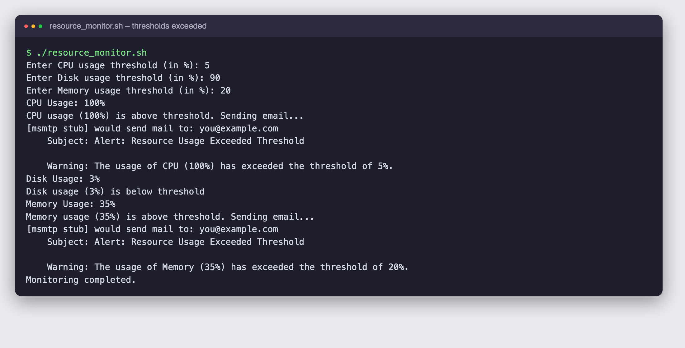
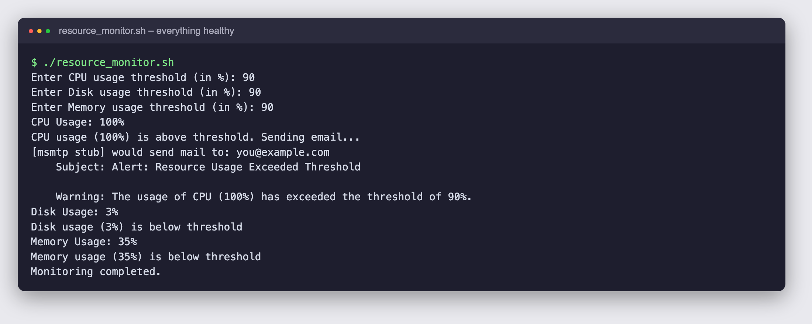

# System Resource Usage Monitor with Email Alerts

A lightweight Bash tool that checks **CPU, disk and memory usage** on a Linux machine and sends an **email alert** whenever a usage figure goes above a threshold you choose.

> This repository documents the project (description, design, screenshots). The script itself lives in a private repository.

## Screenshots

**Thresholds exceeded: an alert is "sent" for each metric over its limit**



**All metrics under their thresholds: no mail**



_Captured on macOS, where `top`/`free` do not exist in their Linux form, using tiny shims that print real macOS readings in Linux format and a stub `msmtp` that prints the email instead of sending it. On Linux the script calls the real tools and `msmtp`._

## Features
- Interactive: asks for a CPU, disk and memory threshold (in %) at start.
- Checks all three metrics in one pass and prints each reading with a verdict.
- Sends one email per metric over its threshold, with the metric name, current value and limit.
- Uses [`msmtp`](https://marlam.de/msmtp/) with any SMTP provider (Gmail app password works), so there is no mail server to run.
- Plain Bash; works well from `cron` for scheduled checks.

## How it works
1. **Input**: `read -p` collects the three thresholds.
2. **CPU**: `top -bn1` is parsed to get the idle percentage; usage = `100 - idle`.
3. **Disk**: `df /` gives the root filesystem's use%.
4. **Memory**: `free -m` supplies used and total megabytes, converted to a percentage.
5. **Compare**: each reading is compared with its threshold using `bc -l` (so decimals work).
6. **Alert**: when over, `send_email` builds a short message (`Warning: The usage of Memory (85%) has exceeded the threshold of 80%.`) and pipes it to `msmtp`.

```
thresholds -> read CPU / Disk / Memory -> compare (bc) -> over limit? -> msmtp -> inbox
```

## Requirements
`bash`, `bc`, `awk`, `sed`, `top`, `free`, `df`, and `msmtp` configured in `~/.msmtprc` (SMTP host, port 587, TLS, user, app password; `chmod 600`).

## Known limitations
- The CPU parsing pattern expects an older `top` layout, so on current Linux builds the CPU reading can come out as 100%.
- The "Memory Usage" figure is computed as `100 - used%`, i.e. it reports free memory, not used memory.
- Recipient and sender addresses are set inside the script.

## Author
Karthik B. Licensed under GPL-3.0.
